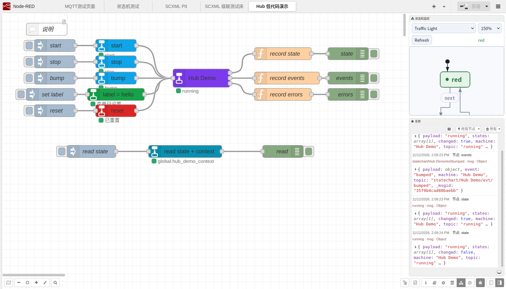

# @changzhen976/node-red-contrib-statechart

**English** · [简体中文](README.md)


Build event-driven flows with visual state charts in Node-RED.

Each state chart is exposed by one **Hub**: events, variables and read requests enter on the left; state, chart `<send>` events and errors/done leave on the right. Peripheral nodes no longer need to select the same machine repeatedly.

```text
inject / event / set / read ──▶ ┌──────────────┐ ──▶ state
                               │ statechart-hub│ ──▶ chart events
                               └──────────────┘ ──▶ errors / done
```

Editing is GUI-first; SCXML 1.0 import/export is available when needed.

## Install

```sh
npm install @changzhen976/node-red-contrib-statechart
```

To install uncommitted local changes:

```sh
npm pack
cd ~/.node-red
npm install /path/to/changzhen976-node-red-contrib-statechart-<version>.tgz
```

Restart Node-RED. A **State chart** category appears in the palette.

Requirements: Node-RED 5.x, Node.js ≥ 22.9, and a browser with Web Components.

## Five-minute start

1. Import [`examples/hub-demo.json`](examples/hub-demo.json) as a copy;
2. Click **Deploy**;
3. Open the **Hub 低代码演示** tab;
4. Click `start` → `bump` ×2 → `set label` → `read state`;
5. Watch the Hub outputs and the global context key `hub_demo_context`;
6. Click `reset` to return to the initial state.

The example contains:

```text
inject → statechart-event (start/stop/bump) ─┐
inject → statechart-set (label=hello) ──────┼─▶ statechart-hub
inject → statechart-read (global context) ──┘
```

Minimal example: [`examples/traffic-light.json`](examples/traffic-light.json).



*Typical usage: choose the machine once on the Hub; action nodes no longer repeat the Machine selector, and the three outputs feed debug/downstream nodes directly.*


## Nodes

| Node | Purpose |
|---|---|
| `statechart-machine` | config node: state chart document and session |
| `statechart-hub` | exposes one state chart to the flow: 1 input, 3 outputs |
| `statechart-event` | sends a fixed or `msg.event` event |
| `statechart-set` | assigns one or more state chart variables |
| `statechart-read` | reads state/variable/snapshot and can write flow/global context |
| `statechart-reset` | sends a reset command |

`statechart-machine` is not in the palette; a Hub references it. **A state chart can be hosted by only one Hub**; a second Hub fails at runtime with a red status.

### `statechart-hub`

```text
Machine:  choose a statechart-machine
Input:    msg.event / msg.topic / msg.command
Output 1: state + variables
Output 2: chart <send> events
Output 3: errors / done
```

Use one Hub per machine. After removing the owning Hub, redeploy before another Hub can take over.

### `statechart-event`

Event only:

```text
Event: cmd.start
Data:  none
```

Event with data:

```text
Event: sensor.temp
Data:  fixed JSON {"value": 85}
```

Data can also come from `msg.payload`, or flow/global context.

### `statechart-set`

Single variable:

```text
Mode:     single
Variable: temp
Value:    msg.payload
```

Batch:

```text
Mode: object
payload = { "temp": 85, "mode": "cooling" }
```

Value sources: `msg.payload`, fixed JSON, string, number, boolean, flow/global context.

### `statechart-read`

```text
Machine: Cell
Read:    snapshot   # snapshot / state / variable
Store:   global
Key:     cellState
```

With no Machine selected, the incoming `msg.states` / `msg.vars` are used. The result is written to flow/global context and also emitted from the node.

### `statechart-reset`

```text
input → send reset to the Hub
```

## Common patterns

| Goal | Flow |
|---|---|
| Event only | `inject → statechart-event (cmd.start, data=none) → Hub` |
| Event with data | `sensor → statechart-event (sensor.temp, fixed JSON) → Hub` |
| Set a variable | `inject → statechart-set (temp = msg.payload) → Hub` |
| Read into context | `inject → statechart-read (snapshot → global:cellState)` |
| Route by state | `Hub output 1 → switch (msg.payload = "running")` |

For parallel machines, inspect `msg.states`. Snapshots are not cleared automatically; trigger read again for a fresh value.

## Hub input and outputs

| Direction | Common fields |
|---|---|
| Input | `event` / `topic` + optional `payload`; `command: set/reset/read` |
| Output 1 state | `payload`, `states`, `vars`, `changed`, `event`, `machine`, `topic` |
| Output 2 chart events | `payload`, `event`, `machine`, `topic` |
| Output 3 error/done | `payload`, `error` or `done`; missing-machine and Hub conflicts also report here |

See [docs/hub-contract.md](docs/hub-contract.md) for full fields, config and migration from in/out.

## Editing state charts

The `statechart-machine` dialog has three tables:

- **States**: id, kind, parent, initial, entry/exit actions;
- **Transitions**: source, target, event, condition, actions, delay;
- **Variables**: id, expression.

It supports hierarchy, parallel states, history, guards, delayed transitions and structured actions. The advanced section accepts raw SCXML or ProjectDoc JSON.

**Open full editor** launches the `statechart-kit` full-screen Vue editor. Save back to Node-RED, then click Update/Deploy. The editor follows the Node-RED UI language (English or Chinese, including diagnostics), and its side panes can be resized or collapsed.

## Monitoring

The **State chart** sidebar shows a read-only live chart with parallel-state highlighting and zoom.

The monitor, full editor and API use a capability token; with `adminAuth` enabled the token endpoint requires `flows.read`. Without it, bind Node-RED to a private network or Tailscale.

## Examples

- [`examples/hub-demo.json`](examples/hub-demo.json): Hub + event/set/read/reset, recommended first;
- [`examples/traffic-light.json`](examples/traffic-light.json): smallest state cycle;
- [`examples/cascade-test.json`](examples/cascade-test.json): three-machine cascade test bed;
- [`examples/demo-suite.json`](examples/demo-suite.json): 6 tabs, 8 machines, covering hierarchy, parallel, history, delays and ProjectDoc.

Automated cascade test:

```sh
CASCADE_BASE=http://localhost:1880 npm run test:cascade
```

See [`examples/README.md`](examples/README.md).

## Compatibility and limits

| Item | Target |
|---|---|
| Node-RED | 5.x (test server 5.0.0, dev 5.0.9) |
| Node.js | ≥ 22.9 (24 recommended) |
| Engine | `@tinyactors/scxmljs@0.2.0-dev.0` |
| Editor | `statechart-kit/vue` 0.11.0 (bundled at build time) |
| XML | `@xmldom/xmldom` |

Known limits:

- One Hub per state chart;
- Cross-tab machines need `link` nodes or must stay in one tab;
- `<scxml-view>` has upstream layout limits for history directly under parallel;
- The English UI covers the toolbar, structure/property labels, buttons and validation diagnostics; a few deep controls are still hardcoded in Chinese by kit 0.11;
- Guarded transitions between the same states may still overlap in complex charts.

## Development

```sh
npm install --include=dev
npm test                 # build + 44 runtime/lifecycle cases
npm run typecheck
npm run verify:all       # typecheck, Node 22.9, kit and package checks
```

Live-environment regressions:

```sh
# Clean instance: starts a temporary Node-RED and runs browser, server E2E and cascade
GECKODRIVER=/path/to/geckodriver npm run test:live

# Against an existing Node-RED
NODERED_URL=http://localhost:1880/ npm run test:e2e

# Browser: tray editor + monitor, and the standalone editor
GECKODRIVER=/path/to/geckodriver NODERED_URL=http://localhost:1880/ npm run test:browser
GECKODRIVER=/path/to/geckodriver NODERED_URL=http://localhost:1880/ npm run test:p4

# Or everything
STATECHART_BROWSER=1 STATECHART_E2E=1 \
  GECKODRIVER=/path/to/geckodriver NODERED_URL=http://localhost:1880/ npm run verify:all
```

More documentation:

- [Documentation index](docs/README.md)
- [Hub input/output contract](docs/hub-contract.md)
- [Examples](examples/README.md)
- [Refactor roadmap](docs/refactor-roadmap.md)
- [Contributing](CONTRIBUTING.md)

## License

MIT. See [LICENSE](LICENSE) and [NOTICE](NOTICE). Third-party notices are in
[THIRD_PARTY_LICENSES.md](THIRD_PARTY_LICENSES.md).
