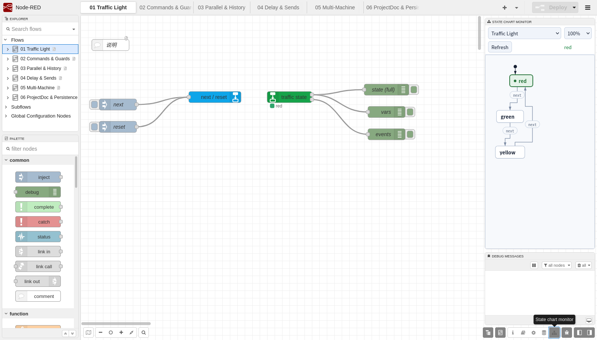
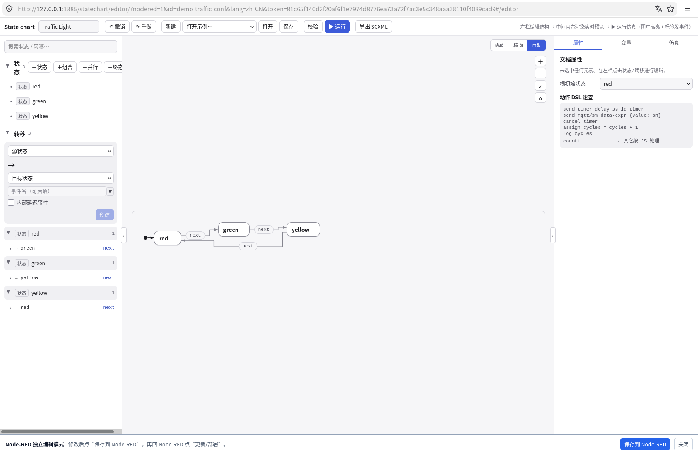

# @changzhen976/node-red-contrib-statechart

[English](README.en.md) · **简体中文**


在 Node-RED 中用可视化状态机（state chart）编排事件驱动逻辑：用消息驱动状态变化，用状态和变量驱动后续流程。

默认全程 GUI 编辑，不需要手写 XML；需要时可导入/导出 SCXML 1.0，交给标准引擎执行。

## 界面

**在 Node-RED 右侧栏实时监控**：活动状态高亮，可切换机器、缩放，变量快照可选。



**独立全屏编辑器**：从状态机配置窗口的「打开完整编辑器」进入，编辑完成后回写并部署。



## 功能

- 在 Node-RED 编辑器中编辑状态、转移、变量和动作；
- 支持层级状态、并行状态、历史伪态、条件转移和延时转移；
- 支持 `assign`、`send`、`cancel`、`log` 和自定义 JS 动作；
- 通过 `msg.command = set/reset/event` 控制状态机；
- 状态、变量和图内 `<send>` 事件可作为 Node-RED 消息输出；
- 可选变量 context 持久化；
- 内置只读实时状态图；
- 多状态机独立会话；
- 中英文界面和帮助；
- 提供完整编辑器，可复用 creator 的 Vue 三栏/画布。

## 环境要求

| 项 | 要求 |
|---|---|
| Node-RED | 5.x |
| Node.js | ≥ 22.9 |
| 浏览器 | 支持 Web Components 和 ES2022 |

## 安装

```sh
npm install @changzhen976/node-red-contrib-statechart
```

> 需要装本地改动时，也可以从源码打包安装：

```sh
npm pack
cd ~/.node-red
npm install /path/to/changzhen976-node-red-contrib-statechart-<version>.tgz
```

重启 Node-RED 后，左侧节点面板会出现 **状态机** 分类。

## 快速开始

1. 在 Node-RED 中导入 [`examples/demo-suite.json`](examples/demo-suite.json)，选择“导入副本”；
2. 点击 **部署**；
3. 打开右侧 **状态机** 侧栏；
4. 进入 `01 Traffic Light` tab，点击 **next**；
5. 观察状态从 red → green → yellow → red。

更小的示例：[`examples/traffic-light.json`](examples/traffic-light.json)。

## 节点

| 节点 | 类型 | 作用 |
|---|---|---|
| `statechart-machine` | config node | 保存状态机文档，持有独立会话和事件总线 |
| `statechart-in` | 输入节点 | 把消息转换成状态机事件，或执行 `set/reset` 命令 |
| `statechart-out` | 输出节点 | 输出状态/变量、图内 `<send>` 事件和运行错误 |

`statechart-machine` 是 config node，不在左侧 palette 中。添加 `statechart-in` 或 `statechart-out` 后，在 **Machine** 下拉右侧点 **＋** 即可新建；每个状态机是独立会话。

## 编辑状态机

打开 `statechart-machine` 配置窗口可使用三张表：

- **States**：id、kind、parent、initial、entry/exit actions；
- **Transitions**：source、target、event、condition、actions、delay；
- **Variables**：id、expression。

支持添加/删除、父/子状态选择、根 initial、结构化 actions 编辑和实时结构校验；高级区可编辑原始 SCXML 或 ProjectDoc JSON。

配置窗口还提供 **打开完整编辑器**：在新标签页打开全屏 Vue 编辑器，可切换所有状态图（state chart），编辑后通过 **保存到 Node-RED** 回写，再回到 Node-RED 点 Update/Deploy。

## 输入命令

```js
{ topic: "next" }                                      // 普通事件
{ command: "event", event: "next", payload: { ... } }  // 显式事件
{ command: "set", payload: { temp: 85 } }              // 设置变量并自动发 update
{ command: "reset" }                                   // 回到初始态
```

`set` 只接受对象 payload，会校验变量已在 `<data>` 中声明；完成后自动发送 `updateEvent`（默认 `update`）。`persistVars` 打开时，变量会写入 Node-RED context。

## 输出

`statechart-out` 有两个输出：

```js
// 输出 1：状态
msg.payload // 单状态为字符串，并行状态为数组
msg.states  // 始终是数组
msg.vars    // includeVars 时
msg.changed
msg.event
msg.machine
msg.topic

// 输出 2：图内 <send>
msg.payload
msg.event
msg.machine
msg.topic
```

可配置 `outputMode`（`state` / `event` / `both`）、`stateTopic`、`eventTopic`；内部 send 默认过滤，调试时可打开 `includeInternalSends`。

## 监控

在编辑器右侧打开 **状态机** 侧栏查看只读实时状态图；状态每 400 ms 刷新，支持并行状态多盒子高亮和 100%–220% 缩放。

监控页、完整编辑器和 API 使用进程级 capability token，由编辑器自动获取并带入 URL。启用 `adminAuth` 时 token 接口要求 `flows.read`；未启用时请将 Node-RED 绑定在私网或 Tailscale，避免直接暴露公网。

## 示例

[`examples/demo-suite.json`](examples/demo-suite.json) 包含 6 个 tab、8 台机器：

- Traffic Light：基础循环；
- Commands & Guards：`set/reset/event`、条件、`send`；
- Parallel & History：并行状态、历史恢复；
- Delay & Sends：延时转移和图内发送；
- Multi-Machine：两台机器独立会话；
- ProjectDoc & Persistence：ProjectDoc、final 状态、变量持久化。

详见 [`examples/README.md`](examples/README.md)。

## 语言与安全

编辑器、表单和帮助自动跟随 Node-RED 语言，内置 `en-US`、`zh-CN` 和 `zh` 回退。

运行时状态由编辑器按当前语言翻译；`node.error` 的文本跟随 Node-RED 服务端语言，可通过 `settings.lang` 配置。

监控和完整编辑器使用 capability token；静态资源公开，monitor 页面、编辑器首页和 API 需要 token。默认建议只在可信网络中使用。

## 与 SCXML 的关系

默认工作流完全在 GUI 中完成，不需要接触 XML。运行时会把状态机序列化为 SCXML 1.0，交给 `@tinyactors/scxmljs` 引擎；高级区、导入/导出仍保留 SCXML 读写能力，便于与其他 SCXML 工具互通或排障。

## 兼容性

| 项 | 目标 |
|---|---|
| Node-RED | 5.x（实测 5.0.9） |
| Node.js | ≥ 22.9（推荐 24） |
| 引擎 | `@tinyactors/scxmljs@0.2.0-dev.0` |
| XML | `@xmldom/xmldom` |
| 模块格式 | CJS 入口，ESM 引擎动态加载 |

## 开发

```sh
npm install --include=dev
npm test
npm run verify:all
```

浏览器回归需要 Firefox、geckodriver 和运行中的 Node-RED：

```sh
STATECHART_BROWSER=1 GECKODRIVER=/path/to/geckodriver \
  NODERED_URL=http://localhost:1880/ npm run verify:all
```

更多文档：

- [重构路线：以 statechart-kit 为核心](docs/refactor-roadmap.md)
- [示例说明](examples/README.md)
- [资源消耗评估](docs/resource-profile.md)
- [完整编辑器设计](docs/p4-standalone-editor.md)（历史方案，0.2.0 将被 kit 编辑器替换）
- [贡献指南](CONTRIBUTING.md)

## 许可

MIT，见 [LICENSE](LICENSE) 与 [NOTICE](NOTICE)；第三方组件许可见 [THIRD_PARTY_LICENSES.md](THIRD_PARTY_LICENSES.md)。
